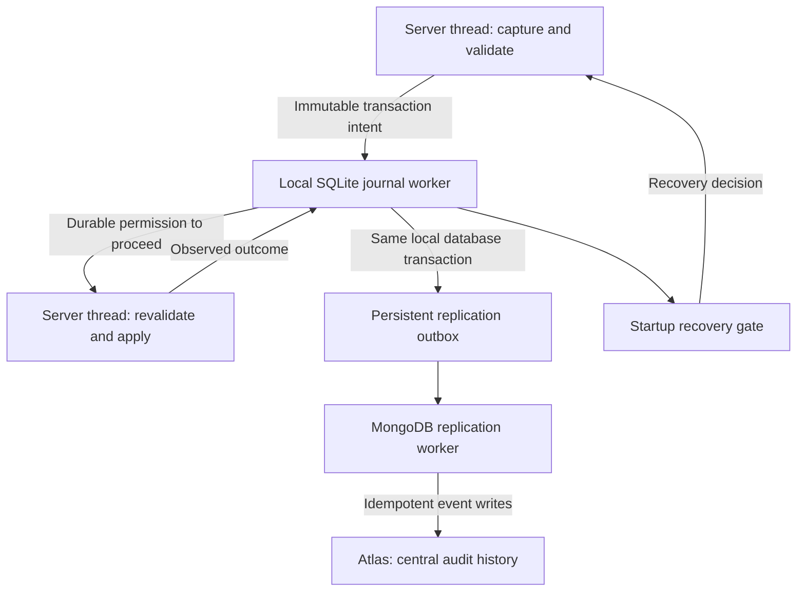

# Deferred H1 hybrid architecture proposal

> Historical proposal recorded 25 November 2026. Retained for future review. The approved v0.1.0 implementation is SQLite-only; this document does not describe shipped MongoDB functionality. In particular, ARMED, replication, checkpoints, remote credentials and retention workers below are proposals only. Reverify time-sensitive platform limits and driver compatibility before future implementation.

**I recommend the hybrid approach: a durable local SQLite journal for recovery, with asynchronous replication to MongoDB Atlas for central auditing.**

It offers meaningful benefits: Atlas outages do not immediately stop sales, network latency stays outside Minecraft’s transaction path, and transaction evidence survives a server-process crash. **It does not, by itself, make item removal and Numismatics payment crash-atomic.** That distinction must remain explicit.

This proposal is dated **25 November 2026**. No implementation or database configuration changes have been made.

**Comparison of the three approaches**

| Approach | Durability gate before mutation | Atlas outage behaviour | Central moderator auditing | Principal limitation |
|---|---|---|---|---|
| **Local SQLite ledger** | Local durable commit | Sales continue | Requires exports or another service | Local disk loss can destroy the only ledger copy |
| **MongoDB-only ledger** | Confirmed remote durable write | New sales must wait or fail closed | Immediate central availability when healthy | Every transaction depends on network/database availability |
| **Hybrid SQLite + MongoDB** | Local durable commit | Sales continue within configured backlog limits | Eventually consistent central history | Unsynchronised records remain vulnerable to local disk loss |

MongoDB-only can satisfy the “no blocking network operations on the server thread” requirement through asynchronous continuations. However, the player still waits for remote acknowledgements before the sale can proceed. Moving that wait off-thread prevents tick blocking; it does not remove the availability dependency.

The hybrid approach makes MongoDB the preferred **central persistence platform**, while retaining a deliberately narrower local authority for recovery.

**Recommended component boundaries**

Use separate execution resources:

- **Minecraft server thread:** shop checks, inventory snapshots, item mutations, balance operations and verification.
- **Single local journal writer:** SQLite transactions, durability operations and persistent circuit-breaker changes.
- **Bounded MongoDB worker:** connection management, replication, retries and audit reads.
- **Moderator audit service:** queries central records; it does not directly mutate Minecraft inventories or balances.

A stalled MongoDB worker must never starve the local journal writer. Neither worker receives live Minecraft objects—only immutable, serialised transaction data.

**Transaction protocol**

I propose three separate status dimensions:

| Dimension | Example values |
|---|---|
| Execution | `PREPARED`, `ARMED`, `APPLIED_MEMORY`, `CANCELLED`, `ROLLED_BACK_MEMORY`, `RECOVERY_REQUIRED` |
| Game-state durability | `UNCONFIRMED`, `CHECKPOINT_CONFIRMED` |
| Replication | `PENDING`, `ACKNOWLEDGED`, `CONFLICT`, `BLOCKED` |

A record being synchronised to Atlas must never automatically imply that its Minecraft effects are durably settled.

The normal sequence would be:

1. **Capture the intent on the server thread.**  
   Generate the transaction ID and capture shop configuration, exact item/component matches, source identities, before/after images and both Numismatics balance fields.

2. **Persist `PREPARED` locally.**  
   The journal worker commits the intent, snapshots and replication-outbox entry together. Nothing may mutate before this durable acknowledgement.

3. **Revalidate on the server thread.**  
   Because the operation has become asynchronous, the original Treasury checks are now stale. Recheck module configuration, player connection, dimension, proximity, shop identity, mode, template, lot size, price, inventory contents, storage UUIDs and account state. Cancel if anything relevant changed.

4. **Persist `ARMED` locally.**  
   This records that the transaction may now attempt mutations. After its acknowledgement, revalidate once more immediately before applying effects.

5. **Apply and verify synchronously in memory.**  
   Remove items, verify removal, issue payment and verify both balance fields. Perform compensation where necessary. No network or database operation occurs inside this section.

6. **Persist the observed outcome locally.**  
   Record `APPLIED_MEMORY`, `ROLLED_BACK_MEMORY` or `RECOVERY_REQUIRED`. A successful user response should follow the durable outcome acknowledgement. Keep another bulk transaction for the same resources from starting until this acknowledgement arrives.

7. **Replicate independently.**  
   The MongoDB worker drains the persistent outbox. A failure here does not repeat the economic transaction.

Late acknowledgements require a transaction-generation token: a disconnected player, cancelled request or expired continuation must not suddenly execute when an old database operation finishes.

**Local journal durability**

Use SQLite on persistent local storage with:

- WAL mode.
- `synchronous=FULL`.
- One application writer.
- Bounded queues and transaction payloads.
- Controlled checkpoints.
- A supported backup procedure that includes outstanding WAL contents.

SQLite documents that WAL with `FULL` synchronises each commit; `NORMAL` can lose recent committed transactions after power loss. WAL also requires same-host storage and is unsuitable for a shared network filesystem. [sqlite.org](https://www.sqlite.org/pragma.html?utm_source=chatgpt.com)

There must be **no `.join()` or blocking database wait on the Minecraft server thread**. It returns control to the game and resumes through a scheduled callback after the writer acknowledges durability.

Asynchronous durability still has costs: it consumes disk bandwidth, can contend with world saves, and adds player-visible transaction latency. It moves the durability wait away from the tick thread; it does not make storage free.

**Authority and crash recovery**

| Stage | Authoritative evidence | Recovery rule |
|---|---|---|
| Before durable intent | Live Minecraft/mod state | No economic transaction has been authorised |
| `PREPARED`, without `ARMED` | Local journal | Protocol guarantees no mutation was authorised; cancel safely |
| `ARMED`, without a durable outcome | Local intent plus actual recovered resources | Outcome uncertain; quarantine rather than replay |
| `APPLIED_MEMORY`, durability unconfirmed | Recorded observation plus recovered game data | Payment/removal may have persisted independently; investigate |
| Verified resource checkpoint | Journal plus independently established save evidence | Record the established durable outcome |
| Replicated to Atlas | Identical origin events in central storage | Suitable for auditing; replication alone cannot settle game-state ambiguity |

**A before/after snapshot is evidence, not an unconditional restoration instruction.** Restoring an old shulker image could overwrite legitimate later contents. Reapplying a recorded payment could pay twice.

For the first implementation, recovery should therefore be conservative:

- Restore persistent circuit-breaker state before accepting new commerce requests.
- Treat armed or uncheckpointed transactions as potentially affected after an unclean shutdown.
- Prevent gameplay/economic access to affected resources while ambiguity is being resolved; a Bulk Commerce-only pause is insufficient if funds can immediately move through another route.
- Record every reconciliation decision and correction as a new, linked event.
- Never clear recovery requirements merely because Atlas contains a “successful” record.

A genuine `CHECKPOINT_CONFIRMED` state requires verified persistence integration with player data, Sophisticated Storage and Numismatics. A timer, dirty flag or ordinary save request is insufficient evidence.

**Until those integrations are established, the hybrid design improves recovery evidence and containment; it does not completely close H1 through automatic reconciliation.**

If the journal is corrupt or a failure prevents writing a breaker flag, startup must fail closed. A previously durable `ARMED` record remains a recovery trigger even when the later breaker update could not be written.

**MongoDB synchronisation and uncertain acknowledgements**

Use immutable events with:

- A UUID transaction ID.
- A monotonically increasing event sequence within that transaction.
- A deterministic unique event key, such as `transactionId:eventSequence`.
- A payload hash and schema version.
- A persistent source sequence for replication tracking.

Replication inserts the same event under the same key on every retry.

| Result | Required action |
|---|---|
| Confirmed durable insert | Persist the local acknowledgement |
| Duplicate key, identical payload | Confirm the existing durable record, then acknowledge locally |
| Duplicate key, different payload | Record a conflict and stop automatic processing |
| Timeout or lost connection | Outcome unknown; retry/reconcile the same event ID |
| Authentication, permission or schema error | Mark replication blocked and alert; avoid endless rapid retries |

Use an explicit majority write concern and journaling policy, with bounded timeouts. MongoDB documents that a write-concern timeout **does not undo changes already made**. A timeout must never trigger a second item removal or payment. [MongoDB Docs](https://www.mongodb.com/docs/manual/reference/write-concern/?utm_source=chatgpt.com)

Driver retryable writes are useful transport assistance, but application-level event IDs remain necessary across process restarts and repeated replication attempts. [MongoDB Docs](https://www.mongodb.com/docs/manual/core/retryable-writes/?utm_source=chatgpt.com)

Maintain a persistent outbox rather than an in-memory retry queue. A crash after MongoDB accepts an event but before SQLite records its acknowledgement simply causes an idempotent resend.

**Disagreements between data sources**

Do not use “latest timestamp wins”.

- **MongoDB is behind:** replay missing local events.
- **Same event ID, different content:** quarantine the conflict.
- **MongoDB is ahead after a local restore:** treat this as a restore/recovery incident; do not overwrite either side automatically.
- **Game data disagrees with the ledger:** require resource-level evidence or explicit reconciliation.
- **The local journal is lost during an Atlas outage:** unsynchronised evidence may be unrecoverable.

The hybrid design’s recovery-point objective is therefore conditional:

- Server-process crash with healthy persistent storage: acknowledged local intent should survive.
- Complete local disk loss: recoverability depends on replication and backup lag.
- Zero loss of intent under host loss would require an additional remote durability gate or equivalent replicated storage.

**Identifiers and future server instances**

Every transaction should include:

| Field | Purpose |
|---|---|
| `transactionId` | Globally identifiable UUID |
| `environment` | Staging or production |
| `serverInstanceId` | Stable identity of the owning server |
| `bootId` | Distinguishes process starts |
| `worldEpochId` | Distinguishes world generations/restores |
| `sourceSequence` | Durable source ordering and replication tracking |
| Player/account UUID | Identifies the seller and account |
| Storage UUIDs | Identifies affected Sophisticated sources |
| Shop dimension and position | Locates the authoritative shop |
| Template, quantity, lots and price | Explains the economic calculation |
| Balance before/after | Includes standard and additional balances |
| Snapshot references and hashes | Supports investigation and recovery |
| Outcome and failure classification | Separates observation from confirmation |
| Software/schema versions | Identifies the implementation used |

Cloned staging worlds must receive a different environment and instance identity. Restored production worlds require an explicit restore epoch.

This provides central auditability across future instances. It does **not** establish distributed ownership of player inventories or bank accounts. Concurrent ownership, transfers and split-brain protection need a separate protocol before multiple servers can mutate shared economic state.

**Cobblemon driver compatibility: verified findings**

I inspected the local Prism **Cobblemon NeoForge 1.8.2+1.21.1** archive. This is a local client-pack reference, not proof of what the production server loads.

| Component | Inspection result |
|---|---|
| `mongodb-driver-core` | Nested JAR, version **4.10.2** |
| `mongodb-driver-sync` | Nested JAR, version **4.10.2** |
| Jar-in-Jar version ranges | Both declare **`[4.10.2,)`** |
| BSON | No BSON classes or BSON JAR found inside that Cobblemon archive |

The broad version ranges matter: NeoForge negotiates embedded library versions, so another mod could affect which version is selected. Adding an unrelocated newer driver could change Cobblemon’s runtime dependencies. [NeoForged docs](https://docs.neoforged.net/toolchain/docs/plugins/mdg/?utm_source=chatgpt.com)

My proposed dependency policy is:

1. Verify the **actual server’s** resolved sync/core/BSON versions and class origins.
2. Reuse a coordinated, tested driver set where compatible; do not mix arbitrary BSON and driver versions.
3. Give Bulk Commerce its own `MongoClient`, credentials and pool. Reusing library classes does not mean sharing Cobblemon’s client.
4. If a compatible shared baseline cannot be established, use a fully relocated private driver set, including BSON and relevant service resources. Test relocation thoroughly.
5. Never upgrade Cobblemon’s shared driver implicitly.

MongoDB’s compatibility table lists Java 21 support for 4.10, with a virtual-thread restriction, and partial MongoDB 8.0 compatibility. Use bounded **platform threads** for a reused 4.10 driver and test the required Atlas operations explicitly. [MongoDB Docs](https://www.mongodb.com/docs/drivers/compatibility/?driver-language=java\&java-driver-framework=java-sync\&utm_source=chatgpt.com)

A synchronous driver running exclusively on the replication worker meets the no-blocking-network-on-server-thread requirement. A reactive driver is not required.

**Security and configuration**

Proposed separation:

| Service | Staging | Production |
|---|---|---|
| Bulk Commerce | `foundry_commerce_staging` | `foundry_commerce_prod` |
| Cobblemon | Separate Cobblemon staging database | Separate Cobblemon production database |

Prefer separate Atlas projects/clusters for staging and production. Separate databases and credentials alone do not isolate resource consumption or cluster outages.

Use service-, environment- and preferably instance-specific users:

- Runtime replicator: insert/find access to its event and payload collections.
- Audit projector: only the permissions needed to maintain the central read model.
- Moderator service: read access; separate permission for recorded reconciliation decisions.
- Provisioning/retention account: schema, index and retention privileges.
- Cobblemon credentials: no access to commerce data.

For enforced instance isolation, use instance-specific collections or an authenticated ingestion service. Collection permissions do not enforce a `serverInstanceId` field inside a shared collection. Atlas supports collection-scoped custom privileges. [MongoDB Docs](https://www.mongodb.com/docs/atlas/security-add-mongodb-roles/?utm_source=chatgpt.com)

Configuration should cover database identity, instance identity, journal path, pool limits, timeouts, retry policy, backlog limits and retention. Credentials should come from a secret environment variable or protected external secret file, never committed TOML or source.

Require TLS, appropriate network allowlisting, sanitised exceptions and no logging of connection URIs or complete client settings.

**Moderator auditing and retention**

Atlas should expose a central read model searchable by transaction ID, player UUID, server, time, shop, storage UUID and recovery status.

Display execution, persistence and replication status separately. Include each server’s last successful sync time so moderators can distinguish “no transactions” from “server has stopped reporting”.

Preserve original events. A moderator correction creates a new linked record containing the operator, reason, evidence and resulting action.

Retention should distinguish:

- Unresolved recovery evidence.
- Unsynchronised records.
- Detailed snapshots.
- Compact transaction summaries.
- Archived records and deduplication receipts.

**Never age out unresolved or unsynchronised records.** Add expiry eligibility only after the required recovery, replication and archival conditions are met. MongoDB TTL deletion is asynchronous, so it is unsuitable as a precise capacity-control mechanism. [MongoDB Docs](https://www.mongodb.com/docs/manual/core/index-ttl/?utm_source=chatgpt.com)

Keep deduplication evidence for the supported backup/replay horizon. Otherwise, restoring an old journal after central records expire could resurrect previously archived events.

Store large NBT snapshots as bounded binary attachments rather than deeply nested BSON. MongoDB’s document limit is 16 MiB; oversized transactions must be rejected or use a deliberately designed attachment mechanism before mutation. [MongoDB Docs](https://www.mongodb.com/docs/manual/core/document/?utm_source=chatgpt.com)

**Performance, capacity and Atlas Free**

Current documented Free-tier limits include approximately **0.5 GB of documents plus indexes**, **100 operations/second**, **500 connections**, and **10 GB inbound/outbound transfer each per rolling seven days**. Monitoring is limited, and native database auditing is unavailable. These quotas would be shared with Cobblemon if both use the same cluster. [MongoDB Docs](https://www.mongodb.com/docs/atlas/reference/free-shared-limitations/?utm_source=chatgpt.com)

Illustrative storage—not measured Foundry traffic:

| Stored payload per transaction | 1,000 transactions/day, retained 30 days |
|---|---:|
| 2 KiB | 58.6 MiB |
| 48 KiB | 1.37 GiB |
| 1 MiB | 29.3 GiB |

Indexes, projections and SQLite/WAL overhead are additional. At 48 KiB per transaction, a one-day replication outage produces roughly **46.9 MiB** of payload backlog.

Free-tier Atlas is reasonable for staging and measured low-volume auditing. Its suitability for production—particularly alongside expanded Cobblemon storage—must be established from actual document sizes and traffic.

Do not assume Free includes ordinary production backup coverage: MongoDB currently documents an optional paid Free-cluster backup subscription in private preview, with daily snapshots and four retained copies. [MongoDB Docs](https://www.mongodb.com/docs/atlas/backup/cloud-backup/free-cluster-backup/?utm_source=chatgpt.com)

For local performance, expect approximately three durability-gated journal commits per normal transaction—prepare, arm and outcome—plus grouped replication acknowledgements and persistence checkpoints. Measure journal latency, server-thread capture/mutation time and world-save contention before choosing batching thresholds.

Use one long-lived commerce client with a small bounded pool; avoid a client per transaction. MongoDB clients maintain their own pools and monitoring connections. [MongoDB Docs](https://www.mongodb.com/docs/drivers/java/sync/current/connection/specify-connection-options/connection-pools/?utm_source=chatgpt.com)

**Outages, monitoring and acceptance gates**

| Condition | Proposed behaviour |
|---|---|
| Atlas temporarily unavailable | Continue locally within configured backlog/disk limits |
| Backlog or disk reserve exceeded | Reject new bulk transactions; preserve existing evidence |
| Local intent cannot be durably recorded | No item or currency mutation |
| Outcome persistence fails after mutation | Pause commerce; retain the armed recovery obligation |
| Uncertain MongoDB acknowledgement | Reconcile/retry the same immutable event |
| Hash conflict, permission or schema failure | Persistent blocked state and operator alert |
| Unclean restart with ambiguous effects | Recovery/maintenance gate before economic access |

Monitor outbox count and bytes, oldest unsynchronised event, last confirmed replication, retry/error classifications, journal commit latency, disk reserve, WAL growth, unresolved transactions, breaker state and central projection lag. Serve status commands from cached metrics rather than making database calls on the server thread.

Before implementation can be accepted, testing must cover every crash boundary, lost acknowledgements, late callbacks, Atlas outages, disk-full/corrupt-journal cases, backup restoration, driver resolution, credential redaction and full-modpack operation.

**My proposed approval scope is the hybrid journal and central audit design, with conservative recovery. Automatic crash reconciliation should remain a separate capability until resource-level persistence proofs are demonstrated.**
